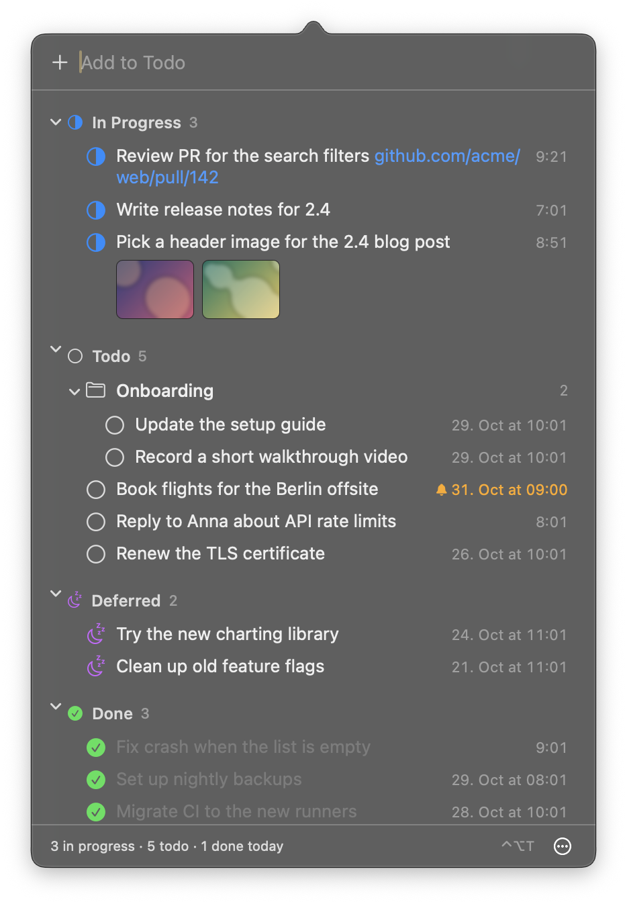
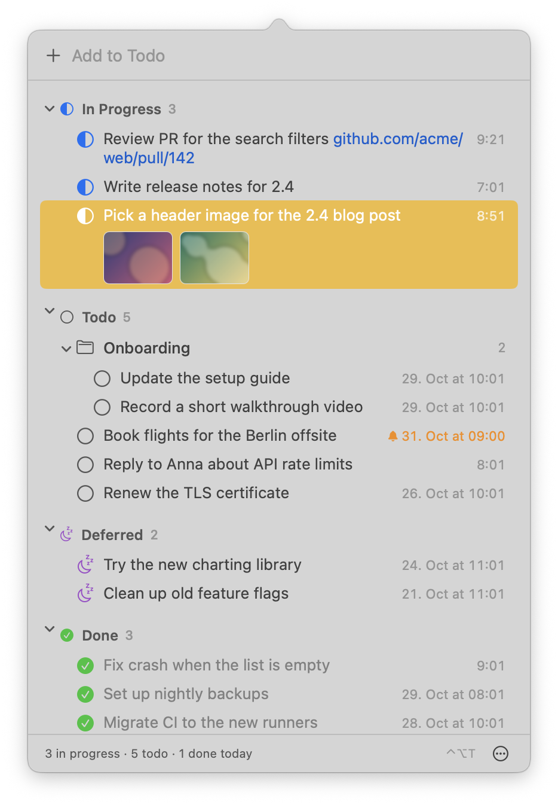

# Task Tracker

A task list for the macOS menu bar. Tasks are sorted into In Progress, Todo, Deferred and Done, can be grouped into folders, and can hold links, images and reminders.

<p>
  
  
</p>

## Install

Needs macOS 14 and Swift 6.

```sh
./scripts/build-app.sh --install
```

This builds the app, copies it to `/Applications` and starts it. Without `--install` it only builds `build/Task Tracker.app`.

## Keys

| Key | |
| --- | --- |
| ⌃⌥T | Open or close the list |
| Return | Add a task, or rename the selected one |
| ⌘Return | New line |
| Space | Mark done |
| ⌘1 – ⌘4 | Move to In Progress, Todo, Deferred, Done |
| ⇧⌘N | Put the selected tasks into a new folder |
| ⌫ | Delete |
| ⌘Z | Undo |

Drag to reorder or move between sections. Paste or drop images and links onto a task. Right-click a task to set a reminder.

## Data

Tasks are saved to `~/Library/Application Support/TaskTracker/tasks.json`, images to the `attachments` folder next to it.

## Development

```sh
swift test
swift build && TASKTRACKER_DATA=/tmp/tasks.json .build/debug/TaskTracker
```
